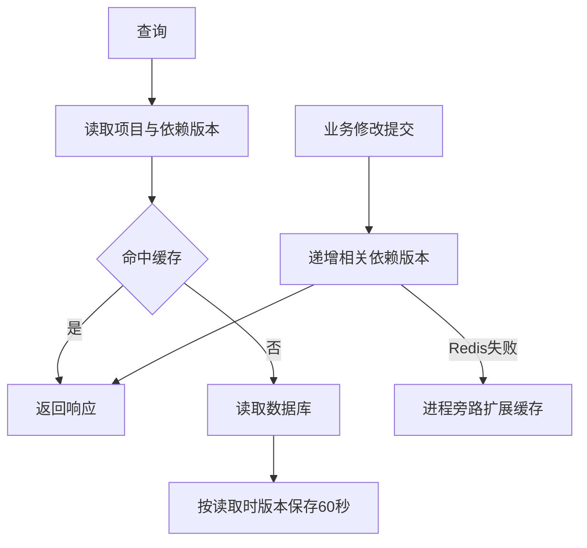

# 缓存与后台易用性实施

## 设计
- 为扩展API缓存增加依赖版本键，缓存身份包含项目代际与依赖组版本；写回使用查询开始时取得的版本，晚返回查询不能污染新代际。
- 稳定GET路由使用显式缓存中间件，保存成功业务响应；规范化列表参数并对身份取摘要，条目60秒有效，最多缓存2MB响应。Redis不可用标记unavailable，未接入为unused。
- 列表依赖catalog，详情依赖detail:漫画ID与author-details，最近阅读依赖recent，收藏依赖favorites，作者列表依赖authors。写入提交后、响应成功前等待相关版本递增；失败时该进程停止使用扩展缓存。导入与启动仍沿用项目代际整体失效。
- 调试保留显式发送与30秒超时，增加JSON输入、接口提示、写入确认及图片响应处理。容量按1000进位显示KB/MB/GB；原始字节统计不变。

## 实现单元
### U1. ✅ 缓存、字体与调试补全（PR #71）
- 文件：backend/src/db/redis.ts、middleware/api-cache.ts、routes/comics.ts、mine.ts、favorite-authors.ts、public/。
- 验证：隔离Redis与业务响应验证命中、查询参数隔离、失效矩阵、在途旧写回、错误不缓存和Redis不可用；调试JSON/确认取消/响应展示浏览器验证；完整执行仓库五项门禁与后端构建。

## 规范影响
- specs/backend-observability.spec.md：缓存覆盖、有效期、命中标记与失效契约。
- specs/backend-pages.spec.md：字体、容量单位与调试完整接口和请求体交互。
- specs/comics-browsing.spec.md、reading-history-and-favorites.spec.md：修改后的相关缓存失效。
