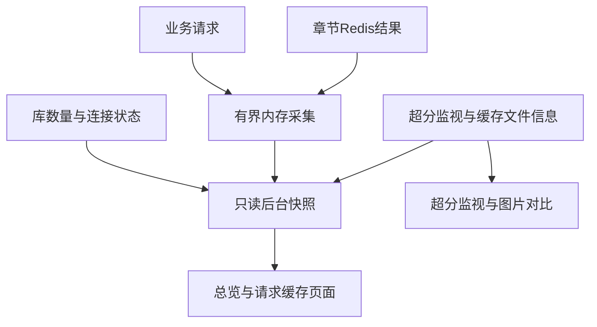

# 漫画后台看板实施计划

## 目标与范围
覆盖定义R1至R8及F1/F2、AE1至AE4。保留原有接口调试和超分预览，统一为本地静态资源工作台，不引入前端构建依赖。

## 技术设计
以下为设计方向，具体实现服从已有Express与静态页面模式。

- 请求开始时分类普通API、原图、超分；结束或断连只记一次，耗时含等待，记录安全路径而非查询参数、正文或内部异常。
- HTTP快照排除监视/健康轮询；保留500条明细及每类进程计数。字节数为完成响应的Content-Length口径，未知单列，断连不当完整传输。
- 章节缓存查询通过现有缓存返回值和响应局部信息标记，业务降级逻辑保持不变。
- 新增后台快照入口；库数量查询限时且快照短期缓存、合并在途刷新，避免轮询放大数据库负担。数据库失败不阻止其它数据返回。
- 超分磁盘统计不调用初始化、不写磁盘、不启动引擎，短期复用结果，缺失/不可读明确区分。
- 新首页为总览，请求缓存页和调试页使用共享样式；既有超分监视保留脚本交互并接入统一导航及新概况。

## 实现单元

### U1. 统一看板与真实采集
- **依赖：** 无。
- **文件：** backend/src/app.ts、routes、services、db/redis.ts、backend/public/。
- **方式：** 先实现采集和快照，再落地导航、总览、分类请求、缓存和超分概况；保留旧调试与预览功能。
- **验证：** 有限记录、断连只计一次、304/HEAD无响应体、缓存不可用与未使用区分、快照失败降级；浏览器验证桌面和窄屏，筛选、暂停刷新、API复制与图片对比。
- **门禁：** 完整执行仓库要求的Flutter格式/分析/测试以及后端格式/lint，另执行TypeScript构建。

## 规范影响
- specs/backend-pages.spec.md：首页职责、统一导航、请求与缓存指标口径、异常与响应式行为。
- specs/super-resolution.spec.md：只读缓存容量信息与监视工作台扩展。

## 风险与处理
- 本地浏览器缓存不可由服务端观测，页面明确提示。
- 重启丢失进程统计；采样明细不等于全历史。
- 只读容量快照允许短暂过时，不影响推理和缓存回收。
