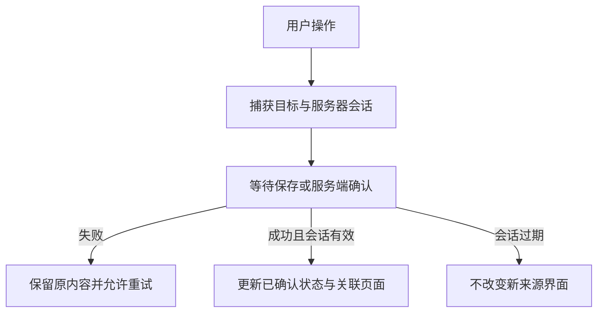

# Flutter 操作逻辑优化实施计划

## 概述与需求

落实定义中的 R1—R8，保留现有产品行为并补齐收藏管理入口。检查已覆盖浏览搜索、详情、书库、阅读、超分、设置、更新及应用壳；集中修复已确认的跨页面状态串扰、操作失败后继续推进和异步引用失效问题。

## 技术决策

- 收藏变更由应用会话级状态负责，成功后立即反映已确认状态；服务器代际隔离和同目标操作互斥贯穿请求及反馈。
- 搜索按页面会话隔离，收藏变更仍同步活跃查询；保持原分页、缓存和搜索历史规则。
- 保持桌面页面栈身份稳定，动画不得销毁页面；设置持久化采用已有串行保存模式。
- 阅读返回与换书复用可传播失败的本机保存入口；自动翻页与人工操作区分，人工操作取消计时器。
- 复用现有测试辅助设施，重点覆盖异步离页、来源切换、嵌套导航与保存失败等跨组件场景。

## 状态流程

## 实施单元

### U1. 修复 Flutter 跨页面操作与失败恢复

- 状态：已完成，五项门禁通过，PR #78。

- 依赖：无。沿用当前分支完成完整变更循环，最终使用同一个面向 master 的 PR。
- 文件：`app/lib/providers/comics_providers.dart`、`app/lib/screens/home_screen.dart`、`app/lib/screens/search_screen.dart`、`app/lib/screens/detail_screen.dart`、`app/lib/screens/mine_screen.dart`、`app/lib/widgets/reading_lists.dart`、`app/lib/widgets/comic_card.dart`、`app/lib/widgets/comic_grid.dart`、`app/lib/screens/reader_screen.dart`、`app/lib/main.dart`、设置和服务器 provider、设置页及更新服务。
- 方法：按上述技术决策修复；保留后端接口和既有数据模型。仅对确实需要稳定状态的区域调整数据层。
- 验证：在现有 `app/test/` 中扩展收藏离页、同作者联动、嵌套搜索、侧栏导航、系统返回与换书保存失败、人工操作停止自动阅读、偏好恢复及平台更新选择回归。完成仓库规定的 Flutter 格式、分析、测试和后端 lint、test 五项门禁。
- 人工检查边界：自动测试不代表真实 Android 安装器、系统剪贴板、文件管理器及托盘的设备验证。

## 规范影响

- `specs/reading-history-and-favorites.spec.md`：收藏页直接取消入口、成功立即同步与失败保留。
- `specs/data-layer.convention.md`：收藏与服务器变更生命周期独立于页面，搜索会话隔离。
- `specs/comics-browsing.spec.md`：嵌套搜索状态与新搜索回到顶部。
- `specs/app-shell.spec.md`、`specs/ui-style.convention.md`：导航保持页面状态，收藏管理入口与反馈。
- `specs/reader.spec.md`、`specs/reading-sequence.spec.md`：所有退出和换书入口遵守保存门禁，人工操作停止自动阅读。
- `specs/settings.spec.md`：持久化失败、损坏偏好及平台更新边界。

## 范围与风险

不修改后端业务接口、不升级依赖、不更改数据库。纯复制和目录打开逻辑经静态检查未发现明确缺陷，不做无依据重构。全量门禁失败需区分本次回归、已有失败与环境限制，不将静态检查表述为真实设备验证。
